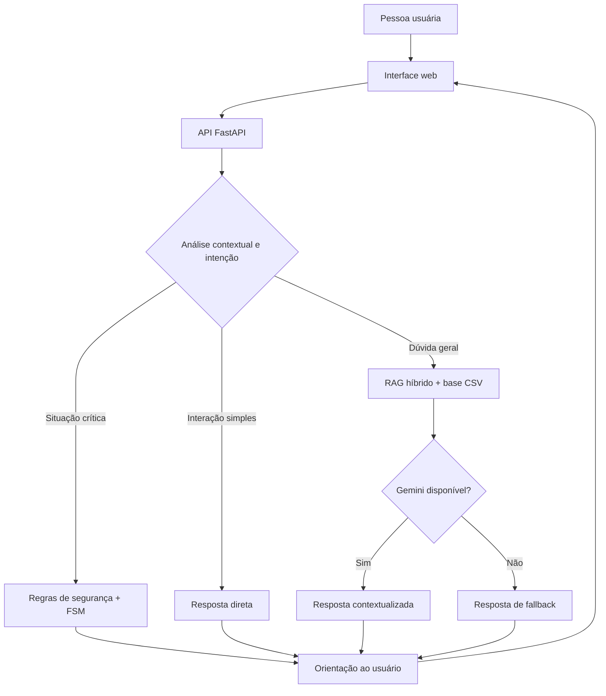

<div align="center">

# 🌺 Motunui
### Inteligência que orienta. Tecnologia que aproxima.

**Assistente de IA para Segurança Digital nas Comunidades**

Um projeto de tecnologia com propósito: tornar orientações sobre golpes, fraudes e privacidade mais claras, acessíveis e humanas.

**TCC • Grupo Motunui • Claro & SoulCode**

[](https://www.python.org/)
[](https://fastapi.tiangolo.com/)
[](#-inteligência-por-trás-do-motunui)
[](#-inteligência-por-trás-do-motunui)
[](#-status-do-projeto)

</div>

---

## ✨ Por que o Motunui existe?

A vida digital oferece possibilidades, mas também exige atenção. Mensagens falsas, links suspeitos, golpes bancários e tentativas de roubo de dados podem transformar tarefas simples em situações de insegurança.

O **Motunui** nasceu para aproximar **inteligência artificial, educação e cidadania digital**. Nossa proposta é oferecer um espaço de conversa em linguagem acessível, com atenção especial às necessidades de pessoas idosas e de quem está desenvolvendo autonomia no ambiente online.

> **Nossa visão:** a tecnologia faz mais sentido quando ajuda as pessoas a se sentirem capazes, informadas e protegidas.

## 🎯 O que a solução oferece

- **Orientação educativa** sobre golpes digitais, fraudes, privacidade e uso seguro da internet.
- **Interpretação de intenções** para distinguir dúvidas gerais de situações que exigem orientações específicas.
- **Recuperação contextual de conhecimento** a partir de uma base estruturada de conteúdos educativos.
- **Fluxos guiados de apoio** para determinadas situações críticas, como relatos de fraude.
- **Comunicação acessível**, priorizando instruções claras e objetivas.
- **Respostas alternativas** quando o serviço generativo não está configurado ou disponível.

> O Motunui é uma ferramenta **educativa**, não substitui bancos, autoridades, profissionais especializados ou canais oficiais de atendimento.

## 🧠 Inteligência por trás do Motunui

A arquitetura foi projetada para **não depender exclusivamente de um modelo generativo**. O backend combina componentes estatísticos e mecanismos determinísticos, cada um com uma função específica:

| Componente | Tecnologia / técnica | Papel na solução |
| --- | --- | --- |
| API | **Python + FastAPI** | Recebe e processa as mensagens do chat |
| Representação semântica | **SentenceTransformers** | Transforma textos em embeddings multilíngues |
| Classificação de intenções | **Scikit-learn + Regressão Logística** | Identifica o tipo de solicitação |
| Recuperação de conhecimento | **RAG híbrido** | Combina similaridade semântica e correspondência lexical |
| Fluxos conversacionais | **FSM — Máquina de Estados Finitos** | Organiza acompanhamentos em etapas |
| Dados e vetores | **Pandas + NumPy** | Processa a base de conhecimento e operações numéricas |
| Geração de linguagem | **Google Gemini (opcional)** | Formula respostas quando a API está configurada e disponível |
| Interface | **HTML + CSS + JavaScript** | Oferece Home institucional e chat web |

### 🔎 Um diferencial: recuperação híbrida

Para dúvidas gerais, o sistema combina **75% de pontuação semântica** e **25% de correspondência lexical**, com critérios de priorização temática e seleção de até **três trechos relevantes** (*Top-K = 3*).

Esses percentuais são **pesos do algoritmo**, não índices de acurácia ou eficácia.

### 🛡️ Outro diferencial: segurança no fluxo

Regras prioritárias e uma **Máquina de Estados Finitos (FSM)** permitem encaminhar determinadas situações críticas por etapas de orientação. O sistema também mantém um **histórico temporário de até oito mensagens por sessão**, com expiração de sessões inativas.

## 🧩 Visão geral da arquitetura



*Diagrama simplificado: os caminhos de processamento variam conforme a intenção e o estado da sessão.*

## 🗂️ Estrutura do projeto

```text
tcc-chatbot-idosos/
├── backend/
│   ├── main.py              # API, classificação, RAG e fluxos
│   ├── P2_Idosos.csv        # Base de conhecimento
│   └── requirements.txt     # Dependências Python
├── frontend/
│   ├── index.html           # Página institucional
│   ├── chat.html            # Interface do chatbot
│   ├── home.css             # Estilos da Home
│   ├── style.css            # Estilos do chat
│   ├── script.js            # Interação com a API
│   ├── Claro.png            # Recurso visual
│   └── fundo.jpg            # Recurso visual
└── .gitignore
```

## 🚀 Como executar localmente

**Pré-requisitos:** Python instalado, Git e conexão com a internet no primeiro carregamento do modelo de embeddings.

### 1. Clone a branch de desenvolvimento

```bash
git clone -b versao-segura https://github.com/carolyn-aviz/tcc-chatbot-idosos.git
cd tcc-chatbot-idosos
```

### 2. Configure o ambiente Python

No **CMD do Windows**, a partir da raiz do projeto:

```cmd
python -m venv venv
venv\Scripts\activate
pip install -r backend\requirements.txt
```

### 3. Inicie o backend

```cmd
cd backend
python -m uvicorn main:app --host 127.0.0.1 --port 8000
```

API local: `http://127.0.0.1:8000`  
Documentação interativa: `http://127.0.0.1:8000/docs`  
Saúde da aplicação: `http://127.0.0.1:8000/api/saude`

### 4. Inicie o frontend

Em **outro CMD**, a partir da raiz do repositório:

```cmd
python -m http.server 5500 --directory frontend
```

- **Home:** http://127.0.0.1:5500/
- **Chat:** http://127.0.0.1:5500/chat.html

**Importante:** confira se `frontend/script.js` aponta para a API local (`http://127.0.0.1:8000`) e se o CORS do backend permite a origem usada no navegador. Caso utilize uma URL pública, configure ambas de forma correspondente.

### 5. Integração opcional com Gemini

A integração está prevista no backend, mas **não é obrigatória para testar os fluxos com fallback**. Para ativá-la, configure `GEMINI_API_KEY` no ambiente, sem colocar a chave no código ou enviá-la ao GitHub. Confirme também o identificador de modelo disponível para sua conta na variável `GEMINI_MODEL`.

## 🔌 Endpoints principais

| Método | Rota | Finalidade |
| --- | --- | --- |
| `POST` | `/api/chat` | Enviar mensagem ao assistente |
| `POST` | `/api/reset` | Reiniciar uma sessão |
| `GET` | `/api/saude` | Consultar informações de saúde do serviço |

Exemplo de requisição:

```json
{
  "mensagem": "Recebi um link suspeito por SMS. O que faço?",
  "session_id": "sessao-exemplo"
}
```

> Em um ambiente público, gere identificadores de sessão próprios por usuário. O valor padrão `default` não é apropriado para conversas simultâneas de pessoas diferentes.

## 📍 Status do projeto

**Protótipo funcional validado localmente.**

**Implementado:** API FastAPI, classificação de intenções, recuperação híbrida, fluxos FSM, histórico temporário, fallback, Home, chat web e versionamento no GitHub.

**Em evolução:** disponibilização externa do frontend e da API, validação do serviço Gemini, testes de acessibilidade com público-alvo e avaliação sistemática da qualidade das respostas.

Não são apresentadas métricas de eficácia contra golpes ou resultados de testes com usuários sem validação empírica.

## 👩‍💻 Quem construiu

O **Grupo Motunui** é formado por quatro desenvolvedoras que uniram tecnologia e propósito social:

| Desenvolvedora | LinkedIn |
| --- | --- |
| **Aline Damasceno** | [Perfil profissional](https://www.linkedin.com/in/aline-damasceno-6a08aa158) |
| **Carolyn Aviz** | [Perfil profissional](https://www.linkedin.com/in/carolyn-aviz) |
| **Laura Almeida** | [Perfil profissional](https://www.linkedin.com/in/laura-c-almeida-78a81731) |
| **Suzane Albino** | [Perfil profissional](https://www.linkedin.com/in/suzanemarcellyalbino) |

*Projeto acadêmico desenvolvido no contexto do TCC Claro & SoulCode. As marcas citadas identificam o contexto do trabalho, sem implicar endosso oficial ao repositório.*

## 📚 Fundamentação e referências técnicas

- [CERT.br — Cartilha de Segurança para Internet](https://cartilha.cert.br/)
- [Lei Geral de Proteção de Dados — Lei nº 13.709/2018](https://www.planalto.gov.br/ccivil_03/_ato2015-2018/2018/lei/l13709.htm)
- [FastAPI — Documentação oficial](https://fastapi.tiangolo.com/)
- [SentenceTransformers — Documentação oficial](https://sbert.net/)
- Lewis et al. (2020), *Retrieval-Augmented Generation for Knowledge-Intensive NLP Tasks*.
- Reimers e Gurevych (2019), *Sentence-BERT: Sentence Embeddings using Siamese BERT-Networks*.

## 🤝 Contribuições e uso responsável

Sugestões de melhoria, correções e discussões técnicas são bem-vindas por meio das *Issues*. Antes de reutilizar o projeto, verifique os termos de uso das dependências e dos recursos visuais. **Nenhuma licença de código aberto foi declarada neste repositório**; a ausência de um arquivo `LICENSE` não autoriza automaticamente reutilização ou redistribuição.

---

<div align="center">

### ❤️ Tecnologia com propósito. Conhecimento que protege.

**Motunui — porque segurança digital também é inclusão.**

</div>
